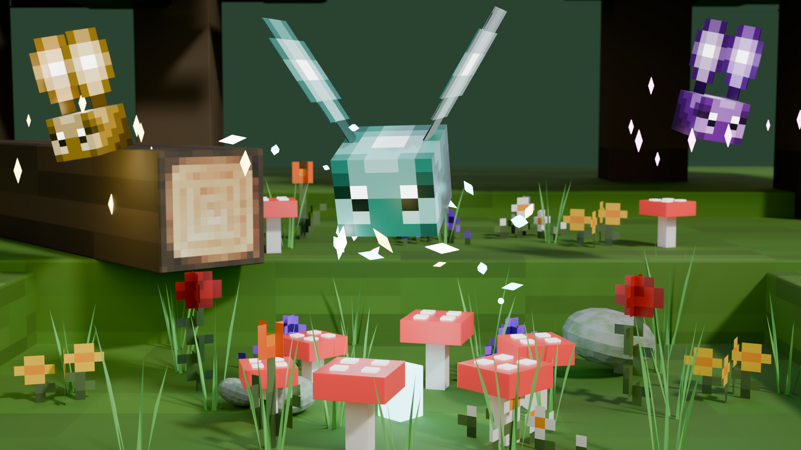

# Mystical Pixie Companion (`pixie`)

An enchanted glowing fairy companion for **Luanti** that accompanies adventurers on their travels. The pixie illuminates the darkness with dynamic aura lighting, sniffs out precious underground ore veins, warns you of stalking monsters and hidden hazards, blesses you with emergency healing pulses in perilous moments, and makes the ultimate sacrifice as a Guardian Angel to rescue you from fatal blows.

---

## Discovering Wild Pixies

Wild pixies are delicate, inquisitive spirits found fluttering among lush tree canopies, wildflower clearings, deep forests, and crystalline grasslands. 

- **Attracting a Pixie**: Wild pixies are naturally drawn to sweet nectar. Hold any wild flower or flora in your hand and stand nearby. An enchanted wild pixie will notice the blossom, pause its aimless flight, turn toward you, and hover playfully right in front of your eyes with gentle chime pulses.
- **Phenotypes**: Wild pixies naturally emerge in eight radiant crystalline shades:
  - **Starlight Azure** (Classic glowing celestial cyan)
  - **Sunbeam Amber** (Warm golden honey hue)
  - **Arcane Violet** (Deep mystical amethyst purple)
  - **Verdant Emerald** (Lush woodland flora green)
  - **Glacial Frost** (Crisp crystalline ice azure)
  - **Ember Ruby** (Fiery crimson sunset glow)
  - **Astral Indigo** (Silvery twilight shade)
  - **Mese Yellow** (Vibrant electric yellow)

---

## Taming & Companionship

### Forming the Bond
To tame a wild pixie, approach it while holding any flower, flora, honey (`farming:honey`), or mese crystal fragment (`default:mese_crystal_fragment`) and **Right-Click** the pixie. 
A shower of sparkling fairy fireworks and musical chimes will celebrate your new friendship. Once bonded, the pixie becomes your loyal traveling companion, matching your pace as you explore the world.

### The Single Companion Rule
A traveler may only maintain a magical bond with **one pixie at a time**. 
If you already possess a bonded pixie and choose to tame another one, your existing companion intuitively senses the new bond and gracefully returns to the wild, allowing you to freely bond with your new friend without clutter or conflicts.

### Loyalty Tiers (Growth Over Time)
Companions are living beings whose bond deepens the longer they journey and survive alongside you. Pixies unlock powerful abilities as their loyalty matures:

- **Tier 1: Fledgling** (0 to 20 minutes):
  - Constant dynamic voxel lighting (13-radius illumination with daylight conservation).
  - Living 3D flight following, shoulder perching, and stationary guard mode.
- **Tier 2: Loyal Companion** (20 to 60 minutes):
  - **Hostile Mob Early-Warning Radar**: Detects dangerous predators and monsters within 14 blocks, sounding warning chimes and casting directional guidance trails.
  - **Survival Triage Healing**: Automatically ministers soothing fairy triage (+2 HP every 8 seconds) when injured.
- **Tier 3: Ancient Guardian** (60+ minutes):
  - **Subterranean Ore Sensing Radar**: Tunes into deep underground mineral resonance, pointing out precious ores (diamonds, mese, ancient debris, quartz, gold).
  - All companions can make the ultimate sacrifice as a **Guardian Angel** on a fatal blow.

Ascending between tiers triggers celebratory chimes, stardust fireworks, and a chat alert. Losing a high-tier companion raises the stakes of survival and gives genuine meaning to player defense.

### Natural Health Regeneration & Feeding
Pixies are living spirits of nature backed by `x_mob_core`:
- **Passive Health Regeneration**: Over time, your pixie's vitality naturally recovers on its own (+1 HP every 2 seconds).
- **Treat & Flower Feeding**: For immediate recovery during combat or hazards, hold any flower, honey, or mese crystal fragment in your hand and **Right-Click** your companion to restore **10 HP** instantly with cheerful heart sparkles. If your pixie is already at maximum health (30 HP), it happily executes a celebratory trick with joyful sparkles without consuming your treat.

### Commanding Your Pixie (Follow & Guard)
With an empty hand (or any regular tool or block), **Right-Click** your bonded pixie to toggle its behavior:
- **Following (Default)**: The pixie flutters gracefully ahead, steering smoothly where you look to light your upcoming steps. If you travel very far or teleport, your companion instantly catches up to your side.
- **Guarding / Waiting**: The pixie settles in place and hovers serenely in a living 1.5m orbit. Use this to place your companion as a cozy glowing lantern at your home cottage, mine shaft entrance, or garden terrace.

### Recalling Your Guarding Pixie (The Fairy Whistle)
If you wander far away while your pixie is guarding, it can be easy to lose track of where you left your companion. Craft an enchanted **Fairy Whistle** (`pixie:whistle`) to stay connected across any distance:
- **Recalling from Guard Mode**: **Right-Click** with the Fairy Whistle in hand to play a celestial flute melody. Your guarding companion intuitively hears your call across the world, materializing at your side in follow mode with celebratory starlight fireworks and a joyful greeting somersault.
- **Trick Command While Following**: When your companion is already accompanying you, **Right-Clicking** with the whistle commands your pixie to perform an acrobatic trick!
- **Check Location & Distance**: **Sneak (Shift) + Right-Click** with the Fairy Whistle (or type `/pixie status` in chat) to instantly check your companion's status, exact guard coordinates, and distance without consuming durability.
- **Durability**: The Fairy Whistle is an enchanted tool with **30 uses** before its crystalline magic dissolves back into fairy dust (durability configurable via `pixie_whistle_durability` in settings). Blowing the whistle when no companion is bonded produces an airy tune without consuming durability.
- **Crafting Recipe**:
  - `1x Any Flower / Flora` + `1x Gold Ingot` (or `Mese Crystal Fragment`) + `1x Stick`

### Natural 3D Flight & Organic Motion
- **Dynamic Speed Scaling**: The pixie's flight velocity dynamically scales to match your movement pace (accelerating up to 36 m/s when sprinting, galloping, or flying), ensuring it stays out in front to light your path.
- **Corridor & Ceiling Awareness**: In open landscapes, your companion scouts ahead with organic lateral sway and vertical elevation waves. In tight mine shafts or tunnels, it automatically contracts its following distance to prevent wall clipping.
- **Mining Crosshair Clearance**: If the pixie ever enters your direct line of sight while mining, building, or aiming, it detects your crosshair cone and gently dodges upward and to the side to keep your vision completely unobstructed.
- **Living Idle States**: When you stop walking, your pixie never freezes dead in place. It smoothly transitions into living behaviors:
  - **Lantern Flank Perch**: Hovers warmly beside your shoulder with a gentle breathing bob.
  - **Blossom Inspection**: Flutters over to investigate and dance above wild flowers within 5 blocks.
  - **Playful Swoops**: Executes gentle crescent sweeps across your field of view.
- **Waiting Mode Living Orbit**: When ordered to wait, the pixie maintains a graceful 1.5m circular orbit with harmonic elevation waves around its guard anchor instead of freezing motionless.

### Releasing Your Pixie Back to the Wild
If you ever wish to part ways and set your companion free:
- **Sneak (Shift) + Right-Click** the pixie (with an empty hand or any item, except healing treats), or
- Type `/pixie release` (or `/pixie unbond`) in chat.

The magical bond will be severed with a gentle parting sparkle, and the pixie will resume its peaceful life as a wild forest spirit.

---

## Magical Abilities & Perks

### 1. Dynamic Aura Lighting (Tier 1+)
Your companion radiates a constant, vibrant field of light (light level 13). Unlike static torches, this luminous aura glides seamlessly alongside you, illuminating dark caves, underwater tunnels, mountain trails, and nighttime journeys without consuming inventory slots or placing nodes manually. In open daylight, it conserves engine cycles.

### 2. Subterranean Danger Radar (Tier 2+)
Pixies are hyper-sensitive to subterranean danger:
- **Hostile Mob Detection & Directional Guidance**: If dangerous monsters (spiders, skeletons, creepers, undead, cultists, or dungeon beasts) stalk you within 14 blocks, your pixie sounds an urgent chime, projects a glittering starlight guidance trail towards the threat, broadcasts a warning in chat, and coordinates with combat evasion to protect itself.

### 3. Tactical Combat Evasion & Rear High Perch
During combat, your companion stays completely clear of your swings and protects itself with multi-tiered combat evasion:
- **Rear High Perch Tactical Anchor**: When combat begins (triggered automatically when taking damage, attacking a monster, being targeted within 12m, or detecting nearby hostiles), the pixie immediately retreats behind your rear shoulder and elevates to a high perch (+2.75m above ground level). This keeps it above melee reach and keeps your forward line of sight completely unobstructed for mining, sword swinging, or bow aiming.
- **Hitbox Raycast Pass-Through**: While in combat evasion stance (configurable via `pixie_combat_retreat_duration`, default 8 seconds, continually refreshed during battle), the companion becomes non-pointable (`pointable = false` and `selectionbox` zeroed). Player sword swings, pickaxe strikes, and bow arrows pass cleanly through the companion towards enemy targets without accidental friendly fire or blocked attacks.
- **Acrobatic Melee Dodge**: If an enemy or stray attack manages to hit the companion, it has an **85% chance to acrobatically dodge** the damage, executing an aerial evasive roll or vertical burst while re-anchoring to safety.
- **Friendly Fire Immunity**: Bonded companions are attuned to their owners and cannot be harmed by player attacks.
- **Universal Hostile Detection**: Compatible with all major Luanti mob mods and games—actively detecting hostile creatures from *x_mobs*, *Mobs Redo*, *Voxelibre / Mineclonia*, *Creatura / Animalia*, *NSSM*, *Dmobs*, *Draconis*, and custom entities.

### 4. Subterranean Ore Sensing (Tier 3+)
Deep beneath the earth, ancient guardians tune into the vibrational resonance of crystalline and metallic deposits. Every few seconds while spelunking, your companion scans the surrounding rock strata for rare ores:
- Detects high-value veins including **diamonds, mese, ancient debris, quartz, emeralds, pyrite, gold, and iron**.
- Prioritizes rarest finds: rare ores trigger high-pitched excited chimes and breakthrough alerts that interrupt lower-priority announcements.
- Projects a sparkling starlight guidance trail that streams directly through rock walls toward the richest nearby deposit.
- Skips scans above maximum configured height (`pixie_ore_max_y`) or under full daytime sunlight to conserve server performance.

### 5. Guardian Angel: Sacrificial Last Stand
Should mortal peril strike and deliver what would be a fatal blow:
- Your faithful pixie companion intercepts the lethal strike in a radiant shockwave of starlight and celestial chimes.
- Your life is saved, immediately restoring you to **+5 HP** (with strictly no temporary speed buffs or invulnerability frames).
- The companion is consumed in the ultimate sacrifice. While you survive your mortal blunder, your companion is gone—encouraging you to venture out into enchanted groves to bond with a new wild spirit.

### 6. Emergency Survival Triage (Tier 2+)
When exploring treacherous ruins or fighting monsters, your pixie watches over your life force:
- If your health falls below maximum (HP < 20), your companion channels restorative triage every 8 seconds, swooping gently over your chest/shoulder while casting soothing healing sparkles and chimes (+2 HP).

### 7. Playful Acrobatic Tricks & Interactions
Pixies possess an exuberant, mischievous personality with 6 fluid flight-integrated acrobatic maneuvers (`flip_back`, `flip_front`, `flip_side`, `flip_side_left`, `spin_around`, `somersault`):
- **Mid-Flight Aerobatics**: While cruising or following at high speed, pixies spontaneously execute aileron barrel rolls, loop-the-loops, and somersault dives without breaking flight velocity.
- **Hovering & Resting Frolics**: While peacefully hovering near you, guarding your base, or pausing near wildflowers, pixies spontaneously twirl in rising air vortexes and tumble in joyful backflips.
- **Subterranean Ore Celebrations**: Discovering rare ores (diamond, mese, ruby) prompts ecstatic 360° loops (`somersault`) or high-speed pirouette twirls (`spin_around`) with celebratory chimes; common ores prompt diving front tucks and barrel rolls.
- **Hostile Threat Warning Maneuvers**: Sighting nearby monsters triggers agile defensive evasive maneuvers—rushing between danger and player with evasive backflips (`flip_back`) or aileron rolls (`flip_side` / `flip_side_left`).
- **Interactive Petting & Treats**: Offering a treat (flower, honey, mese fragment) prompts joyful tricks with radiant fairy sparkles.
- **Emote & Jump Mirroring**: Jumping near your companion encourages them to mirror your leap with an enthusiastic flip or aerial loop.
- **Combat Evasion**: Taking damage triggers an emergency evasive roll recovery to regain balance and dodge danger.
- **Modder API**: External mods can invoke `pixie.play_trick(object, trick_name, options)` to trigger any trick dynamically with custom speed, sparkles, sound, and velocity impulses.

### 8. Defeat Item Drops
Should a wild pixie perish in the dangerous wilderness, its crystalline form dissolves back into the aether, dropping rare materials using `x_mob_core`'s loot system:
- **Diamonds** (rare)
- **Mese Crystals / Glowing Dust** (common)
- **Quartz & Elemental Crystals** (with biome mods enabled)
- **Wild Flora & Blossoms**

---

## Game & Mod Compatibility

The pixie companion includes a modular `compat/` subsystem that seamlessly adapts to the active game and installed mods:

| Game / Mod | Supported Features |
| :--- | :--- |
| **Voxelibre / Mineclonia** (`mcl_*`, `mobs_mc`) | Nether ancient debris, deepslate ores, emeralds, chorus flowers, crimson/warped fungi, and full hostile mob detection (creepers, wardens, wither skeletons, witches). |
| **Everness** (`everness`) | Crystal flowers, azure/coral blossoms, multi-hued crystal ores, quartz crystals, and crystal grassland spawning. |
| **Ethereal NG** (`ethereal`) | Fire flowers, crystal spikes, illumishroom ores, and prairie/grove dirt spawning. |
| **Farming & x_farming** (`farming`, `x_farming`) | Sunflowers, roses, wild cotton, and decorative floral crops. |
| **mobs_monster & Mobs Redo** (`mobs_monster`, `mobs_redo`, `mobs_skeletons`) | Full hostile mob alerts for Dirt Monsters, Dungeon Masters, Fire Spirits, Land Guards, Lava Flans, Mese Monsters, Oerkki, Sand Monsters, Spiders, Stone Monsters, Tree Monsters, and Skeletons. |
| **Animalia & Creatura** (`animalia`, `creatura`) | Dangerous predator alerts for Grizzly Bears and wild wolves, while safely ignoring the player's own tamed pets. |
| **Dragon & Fantasy Mob Mods** (`dmobs`, `draconis`, `nssm`) | Early-warning alerts for Dragons, Wyverns, Orcs, Ogres, Treemen, Evil Pigs, Manticores, Werewolves, Giant Sandworms, and Night Masters. |
| **x_mobs & Pale Watcher** (`x_mobs`, `pale_watcher`) | Hostile faction alerts for spiders, skull archers, skull lancers, skull kings, fallen shamans, and crystal guardians. |
| **Standard / Luanti Game** (`default`, `flowers`) | Standard mineral veins, wild roses, dandelions, violets, and classic flora. |

---

## Inspecting & Personalizing

### Crosshair Inspection Display
Point your crosshair at any pixie in the world to view informative status details:
- **Wild Pixies**: Shows `Wild Pixie (Hold a flower to attract)`.
- **Bonded Companions**: Displays companion name, owner name, current posture (`Following` or `Waiting`), and current health points (e.g. `Health: 30/30`).

### Chat Commands
Manage your companion effortlessly from anywhere using chat:

| Command | Description |
| :--- | :--- |
| `/pixie status` | Checks the status, loyalty tier, bond time, and current health of your companion (including exact coordinates and distance if guarding). |
| `/pixie rename <Name>` | Gives your companion a custom name (e.g., `/pixie rename Navi`). |
| `/pixie nametag [show\|hide\|toggle]` | Toggles or sets the visibility of your companion's in-world floating nametag. |
| `/pixie release` | Cuts the bond loose from afar, allowing your companion to return to the wild. |

---

## Frequently Asked Questions (FAQ)

**Q: Where can I find flowers or treats to tame a pixie?**  
A: Any natural flower or floral plant (such as roses, poppies, dandelions, tulips, violets, or crystal flora from biome mods), honey (`farming:honey`), or mese crystal fragments will attract and tame a pixie.

**Q: Can monsters hurt my pixie?**  
A: Hostile monsters can occasionally hit companions with stray attacks, but the pixie has an **85% acrobatic aerial dodge chance** to deflect damage, automatically retreats to a safe high perch behind your back during battle, and becomes non-pointable so your weapons never strike it. In addition, the pixie naturally regenerates health over time (+1 HP every 2 seconds), or you can feed it any flower, honey, or mese fragment to instantly restore 10 HP.

**Q: What happens if the server restarts or I log off?**  
A: Your pixie companion is safely stowed into your character's profile metadata. When you log back into the world, your companion automatically materializes beside you with its loyalty tier, bond time, and health preserved.

**Q: What happens when I take fatal damage?**  
A: If a bonded companion is accompanying you, it triggers its **Guardian Angel** last stand—absorbing the lethal blow, restoring you to 5 HP, and dissolving in a burst of stardust. If you die when no companion is present or after your companion has already sacrificed itself, the bond is permanently severed, and you will need to find and bond with a new wild fledgling pixie.

**Q: Can other players steal or command my pixie?**  
A: No. A bonded pixie is attuned exclusively to its owner. Other players cannot command, rename, or un-tame your companion.

---

## Configuration & Settings

The mod provides configuration options via engine settings (`settingtypes.txt`):

| Setting | Default | Description |
| :--- | :---: | :--- |
| `pixie_show_nametags` | `true` | Enable or disable in-world floating nametags above tamed companions. |
| `pixie_light_natural_threshold` | `12` | Natural sunlight threshold (0–15) above which dynamic aura lighting shuts off to conserve engine performance. |
| `pixie_ore_max_y` | `64` | Maximum Y elevation for subterranean ore prospecting radar. |
| `pixie_loyalty_tier2_time` | `1200` | Seconds (20 minutes) of companion survival time required to unlock Tier 2 (Loyal Companion). |
| `pixie_loyalty_tier3_time` | `3600` | Seconds (60 minutes) of companion survival time required to unlock Tier 3 (Ancient Guardian). |
| `pixie_whistle_durability` | `30` | Number of uses before an enchanted Fairy Whistle dissolves into fairy dust. |
| `pixie_combat_retreat_duration` | `8.0` | Duration (in seconds) that a companion maintains safe combat evasion stance after battle events. |

---

## Dependencies & Installation

- **`x_mob_core`** (required): Core framework providing high-performance mob lifecycle, physics, animation steering, and loot drops.
- **Optional Games & Mods**: `default`, `flowers`, `everness`, `ethereal`, `farming`, `x_farming`, `mcl_core`, `mcl_flowers`, `mobs_mc`, `x_mobs`, `mobs_monster`, `animalia`, `mobs_redo`, `mobs_skeletons`, `dmobs`, `draconis`, `nssm`.

---

## Author & Licensing

- **Author**: SaKeL
- **Code License**: MIT (see [LICENSE.txt](LICENSE.txt))
- **Media License**: CC-BY-4.0 / CC0 1.0 (see [LICENSE.txt](LICENSE.txt))
  - 3D Model: `models/pixie.glb` by DuckGo & SaKeL (CC-BY-4.0 / MIT)
  - Textures & Icons: `textures/pixie.png`, `textures/pixie_particles.png`, `textures/pixie_whistle.png` by SaKeL (CC-BY-4.0)
  - Screenshot: `screenshot.png` by SaKeL (CC-BY-4.0)
  - Audio: `sounds/pixie_*.ogg` mastered by SaKeL (CC0 1.0 Universal)
